<p align="center">
  
</p>

<p align="center">
  <strong>Your GitHub stats, on a glass cockpit</strong>
</p>

<p align="center">
  <a href="https://nodejs.org/">
    
  </a>
  <a href="https://opensource.org/licenses/MIT">
    
  </a>
  
</p>

<h1>Cockpit Telemetry</h1>

<p>Cockpit Telemetry is a GitHub Action that turns your GitHub stats into an aircraft instrument panel. Your contributions fly the primary flight display, your repos show up as waypoints on a navigation radar, your languages run the engine display, and your latest activity scrolls through an ATC log.</p>

<p>The output is a single animated SVG with no JavaScript, so it plays inside a plain <code>&lt;img&gt;</code> tag on your GitHub profile README.</p>

<p>Inspired by <a href="https://github.com/lowlighter/metrics">lowlighter/metrics</a>, the GitHub stats infographics generator. Cockpit Telemetry is a separate project that keeps the same idea and redraws it as a flight deck, in the same phosphor-green palette as its sister project <a href="https://github.com/maxhayim/flight-path-radar">Flight Path Radar</a>.</p>

<h2>Features</h2>

<ul>
  <li><strong>PFD (primary flight display):</strong> a banking attitude indicator, a speed tape with this week's contributions, an altitude tape with this year's, and a climb/descend mode from your last 30 days against the 30 before</li>
  <li><strong>ND (navigation display):</strong> a rotating radar sweep with your 10 most recently pushed repos as waypoints, lighting up as the sweep passes, and an amber route through the latest four</li>
  <li><strong>EICAS (engine display):</strong> your languages by code size as engine bars in each language's own colour, with total "fuel" in MB</li>
  <li><strong>Instruments:</strong> round gauges for stars, followers, repos and commits this year, with needles that swing to their readings, above a weekly-contributions climb profile</li>
  <li><strong>Duty cycle:</strong> a 24-hour clock of when you're active, in your own time zone</li>
  <li><strong>ATC log:</strong> your latest public events (pushes, releases, pull requests and more), typed in one line at a time</li>
  <li><strong>Annunciators:</strong> status lamps for pull requests, issues, forks, account age and the last sync time</li>
  <li><strong>Zero dependencies:</strong> plain Node.js, nothing to install</li>
  <li>Works with the built-in <code>GITHUB_TOKEN</code></li>
</ul>

<h2>Panels</h2>

<table>
  <tr><th>Panel</th><th>Reading</th><th>Source</th></tr>
  <tr><td>PFD · SPD</td><td>Contributions in the last 7 days</td><td>Contribution calendar</td></tr>
  <tr><td>PFD · ALT</td><td>Contributions in the last 12 months</td><td>Contribution calendar</td></tr>
  <tr><td>PFD · VS</td><td>Last 30 days against the 30 before, in %</td><td>Contribution calendar</td></tr>
  <tr><td>PFD · DEST</td><td>Most recently pushed repo</td><td>Repositories</td></tr>
  <tr><td>ND · REPOS</td><td>10 most recently pushed repos, newest nearest the centre</td><td>Repositories</td></tr>
  <tr><td>EICAS · LANGUAGES</td><td>Top 8 languages by bytes across your own repos</td><td>Repository languages</td></tr>
  <tr><td>Instruments</td><td>Stars, followers, repos, commits this year</td><td>Profile and contributions</td></tr>
  <tr><td>VSD · Weekly Climb</td><td>Contributions per week for the year</td><td>Contribution calendar</td></tr>
  <tr><td>Duty Cycle</td><td>Activity by hour of day</td><td>Public events</td></tr>
  <tr><td>ATC Log</td><td>Latest 7 public events</td><td>Public events</td></tr>
</table>

<h2>Requirements</h2>

<ul>
  <li>A GitHub profile repository (<code>&lt;you&gt;/&lt;you&gt;</code>) with Actions enabled</li>
  <li>Workflow permission <code>contents: write</code>, so the SVG can be pushed to an <code>output</code> branch</li>
  <li>Node.js 20 or newer, only if you run it locally (the Action sets Node up for you)</li>
</ul>

<h2>Installation and Setup</h2>

1. In your profile repository, create `.github/workflows/cockpit-telemetry.yml`:

   ```yaml
   name: Cockpit Telemetry

   on:
     schedule:
       - cron: "0 */12 * * *"   # every 12 hours
     workflow_dispatch:

   permissions:
     contents: write

   jobs:
     build:
       runs-on: ubuntu-latest
       steps:
         - uses: maxhayim/cockpit-telemetry@v1
           with:
             github_user_name: ${{ github.repository_owner }}
             timezone: America/New_York
             outputs: dist/cockpit-telemetry.svg

         - uses: crazy-max/ghaction-github-pages@v4
           with:
             target_branch: output
             build_dir: dist
           env:
             GITHUB_TOKEN: ${{ secrets.GITHUB_TOKEN }}
   ```

   If you already publish another SVG to the `output` branch (for example with Flight Path Radar), add the Cockpit Telemetry step to that same job instead, so both files land in `dist` and one publish step pushes them together.

2. Run the workflow once from the **Actions** tab (**Run workflow**), or wait for the schedule.

3. Add the image to your profile `README.md`:

   ```html
   /<you>/output/cockpit-telemetry.svg" alt="Cockpit Telemetry" width="100%">
   ```

<h2>Usage</h2>

<h3>Inputs</h3>

<table>
  <tr><th>Input</th><th>Default</th><th>Description</th></tr>
  <tr><td><code>github_user_name</code></td><td>(required)</td><td>User whose stats to show.</td></tr>
  <tr><td><code>outputs</code></td><td><code>dist/cockpit-telemetry.svg</code></td><td>One file per line.</td></tr>
  <tr><td><code>timezone</code></td><td><code>UTC</code></td><td>IANA time zone for the Duty Cycle clock, e.g. <code>America/New_York</code>.</td></tr>
  <tr><td><code>github_token</code></td><td><code>github.token</code></td><td>Token used to read profile stats from the GitHub API.</td></tr>
</table>

<h3>Running Locally</h3>

<pre><code>git clone https://github.com/maxhayim/cockpit-telemetry.git
cd cockpit-telemetry
GITHUB_TOKEN=$(gh auth token) node src/cli.mjs &lt;user&gt; out/cockpit-telemetry.svg
GITHUB_TOKEN=$(gh auth token) COCKPIT_TELEMETRY_TZ=Europe/London node src/cli.mjs &lt;user&gt; out/cockpit-telemetry.svg</code></pre>

<p>To work on the design without calling the API, render from a saved stats file such as <code>examples/stats.json</code>:</p>

<pre><code>COCKPIT_TELEMETRY_STATS=examples/stats.json node src/cli.mjs &lt;user&gt; out/cockpit-telemetry.svg</code></pre>

<h2>How It Works</h2>

<ol>
  <li><strong>Fetch the stats.</strong> One GraphQL query reads your profile, your own repositories with their languages, and your contribution calendar. The public events feed adds the latest activity for the Duty Cycle clock and the ATC log.</li>
  <li><strong>Reduce them to readings.</strong> Language bytes are summed across your non-fork repos, the calendar is folded into weekly totals and 30-day trends, and events are bucketed by hour in your time zone.</li>
  <li><strong>Render.</strong> Every panel is drawn as plain SVG and animated with SVG animation (<code>animate</code>, <code>animateTransform</code>), so the file plays on its own in any browser and inside GitHub's image proxy.</li>
</ol>

<h2>Known Limitations</h2>

<ul>
  <li><strong>Dark theme only.</strong> The cockpit look is designed for dark backgrounds, so it stands out as a dark panel on GitHub's light theme.</li>
  <li><strong>Public events only.</strong> The Duty Cycle clock and the ATC log use GitHub's public events feed, which covers roughly your last 100 public events.</li>
  <li><strong>Private repositories</strong> aren't counted with the built-in token, and private contributions only count if you have enabled "Include private contributions on my profile" in your GitHub settings.</li>
  <li><strong>Busy radar.</strong> Long repo names are shortened, and waypoint labels can touch the compass numbers.</li>
  <li><strong>Profile image caching.</strong> GitHub caches README images, so a fresh SVG can take a few minutes to show on your profile.</li>
</ul>

<h2>License</h2>

This project is licensed under the MIT License.

See the [LICENSE](LICENSE) file for details.  
Full license text: https://opensource.org/licenses/MIT

<h2>Contributing</h2>

<p>Pull requests are welcome. Open an issue first to discuss ideas or report bugs.</p>

<h2>Related Projects</h2>

<ul>
  <li><a href="https://github.com/lowlighter/metrics">lowlighter/metrics</a>: the GitHub stats infographics generator that inspired this project</li>
  <li><a href="https://github.com/maxhayim/flight-path-radar">maxhayim/flight-path-radar</a>: the sister project, a stealth plane flying over your contribution grid on a radar screen</li>
  <li><a href="https://github.com/crazy-max/ghaction-github-pages">crazy-max/ghaction-github-pages</a>: used in the example workflow to publish the SVG</li>
</ul>

<h2>Acknowledgments</h2>

<p>Inspired by <a href="https://github.com/lowlighter/metrics">lowlighter/metrics</a> by lowlighter.<br>
GitHub® is a trademark of GitHub, Inc. and is used here solely for interoperability purposes. Aircraft and avionics names are used descriptively.
All other trademarks are the property of their respective owners.</p>
